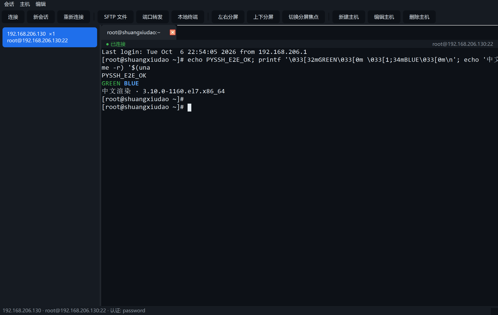
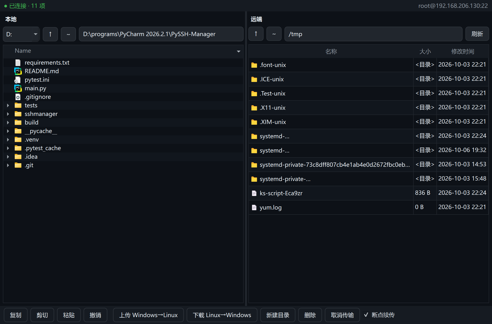
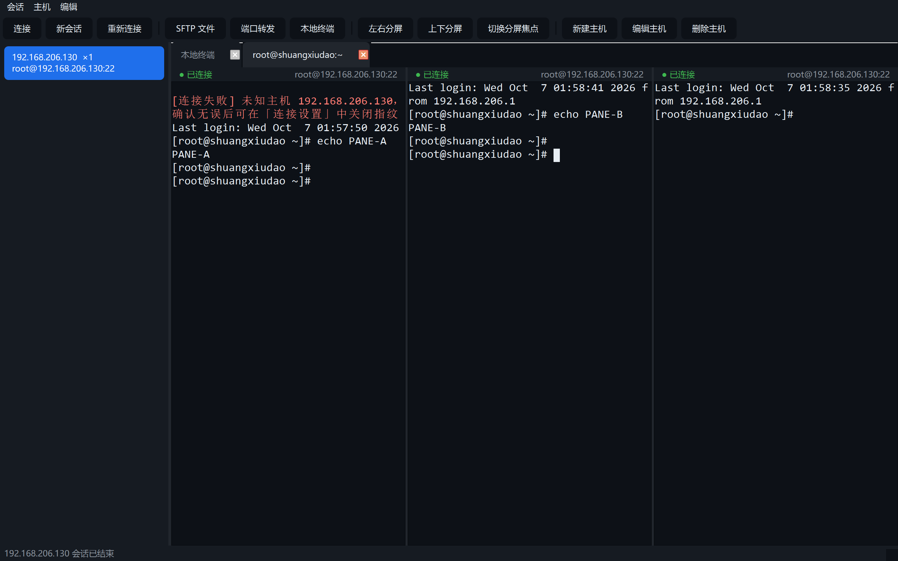
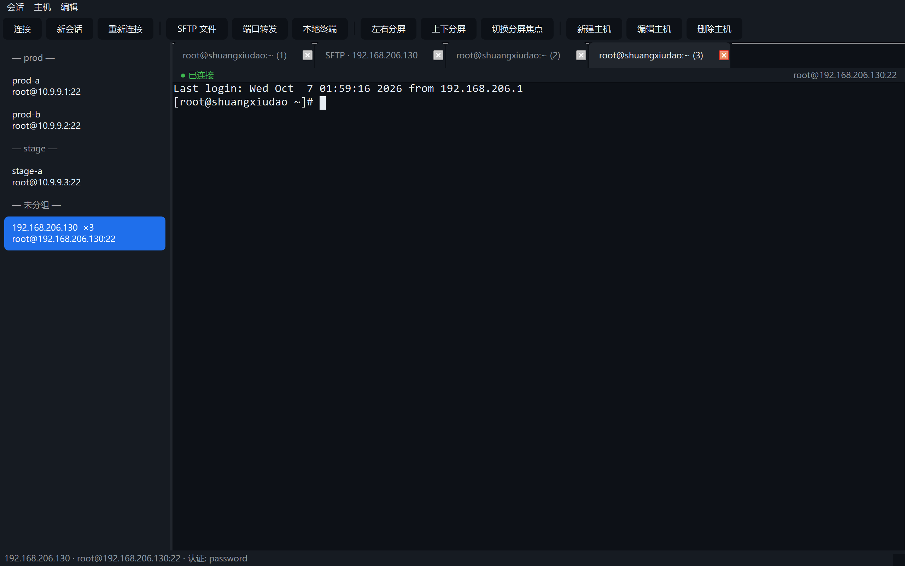
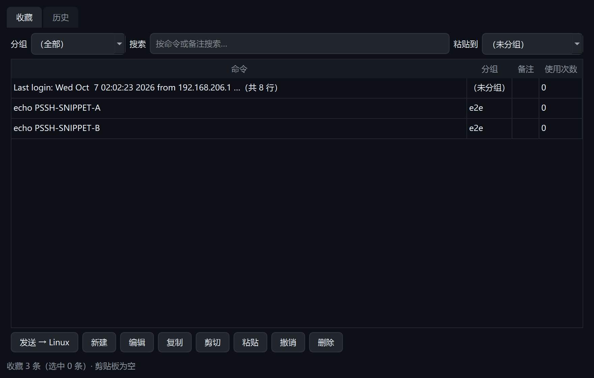

# PySSH Manager

一个用 Python + PySide6 写的 SSH 连接管理器，目标是对齐 [Termius](https://termius.com/) 的核心体验：
真终端仿真、多标签会话、主机列表与加密凭据、密钥认证、主机指纹校验。



| SFTP（含本地 C/D 盘） | 分屏 |
| --- | --- |
|  |  |

| 同一主机多会话 | 命令库（收藏 / 历史） |
| --- | --- |
|  |  |

## 下载与安装（Windows）

不需要装 Python，直接下载打包好的程序：

1. 打开仓库的 **Releases** 页面，下载 `PySSH-Manager-<版本>-windows-x64.zip`
   （想免解压就用 `PySSH-Manager.exe` 单文件版）
2. 解压后双击 `PySSH-Manager.exe` 即可
   - 目录版启动更快（推荐），单文件版只有一个 exe（首次启动会解包，稍慢）
   - 首次连接新主机会提示服务器指纹，确认无误后点「信任」
   - 数据（主机列表 / 加密凭据 / 命令库）保存在 `%APPDATA%\PySSH-Manager\`

> **未做代码签名，Windows SmartScreen 可能提示"未知发布者"，点「更多信息 → 仍要运行」即可。**

没有现成 Release 时，可以在 **Actions** 页面选最新的 `build-windows` 运行，
在 Artifacts 里下载 `PySSH-Manager-windows-x64`（同一份产物）。

## 当前状态

已经可用的功能：

- **真终端仿真**：基于 `pyte` 解析 ANSI/SGR/光标/OSC，`vim`、`top` 这类全屏程序可用
- **字符网格渲染**：自绘终端控件，支持 16 色 + 亮色、加粗/斜体/下划线/反显、块状光标
- **回滚历史**：向上滚动可回看历史输出（鼠标滚轮 / 滚动条）
- **多标签会话**：一个主机一个标签，标签标题跟随远端 OSC 设置
- **主机列表**：JSON 持久化，按最近连接排序
- **凭据加密**：Windows 用系统 DPAPI 加密（`CryptProtectData`），不落明文；其他平台回退 Fernet
- **认证方式**：密码、私钥文件（含 passphrase）
- **主机指纹校验**：使用应用自己的 `known_hosts`，未知主机给出带指纹的明确提示，可一键信任
- **跳板机**：通过另一台主机建立 direct-tcpip 隧道
- **本地终端**：应用内嵌 Windows ConPTY 伪终端（PowerShell / cmd），标签里直接跑本机命令
- **终端里直接双向操作（Windows ↔ Linux）**：不用额外的输入框——
  **Windows→Linux**：直接在终端里打字（支持中文），或 `Ctrl+Shift+V` 把 Windows
  剪贴板内容（含多行脚本）粘进远端；
  **Linux→Windows**：鼠标选中即复制（可在「编辑」菜单关掉）、`Ctrl+Shift+C` 复制、
  `Ctrl+Shift+X` 剪切（复制并清空选区）、`Ctrl+Alt+C` 复制全部输出
- **命令库（收藏 + 历史）**：常用命令按主机或全局收藏，可分组、加备注、记录使用次数；
  历史自动记录发送过的命令（连续重复只留一条），可搜索、再次发送、一键收藏；
  条目本身支持**复制 / 剪切 / 粘贴到别的分组 / 撤销**（`Ctrl+C/X/V/Z`，删除也能撤销）；
  终端里选中一段可直接收藏（`Ctrl+Shift+S`）
- **输出导出**：把终端全部输出（含回滚区）复制到剪贴板或另存为 UTF-8 文本文件
  （`Ctrl+Alt+S`）
- **分屏**：左右 / 上下分屏，最多 4 个面板，每个面板是独立的 SSH 会话，分隔条可拖动调整
- **同一主机多会话**：`Ctrl+Shift+N`（或右键「新会话」）可给一台主机开多条并行会话，
  标签按 `(1)(2)(3)` 编号，侧边栏主机条目显示 `×N`（开着的会话数）；
  「连接」在已有会话时只切到该标签，不会重复连接
- **SFTP 文件管理**：双栏（本地 / 远端）浏览，上传、下载、新建目录、重命名、删除；
  **本地栏可浏览全部盘符**（C: / D: …：盘符下拉 + 路径框 + 上级/主目录按钮，
  双击文件用系统默认程序打开）；
  **支持拖拽**（本地文件/目录拖到远端即上传，远端条目拖到本地即下载）与**目录递归传输**，
  传输带进度条与取消；**断点续传**（下载写 `.part` 临时文件，成功后原子替换；
  重试只补缺失字节）
- **会话录制与回放**：录制为 asciicast v2 格式（可直接用 `asciinema play` 播放），
  应用内回放器支持播放 / 暂停 / 倍速 / 时间轴拖动
- **SSH 密钥管理**：生成 Ed25519 / RSA 密钥（私钥可用口令加密）、查看/复制公钥、
  一键把公钥部署到远端 `~/.ssh/authorized_keys`（幂等）、打开密钥目录
- **PuTTY 密钥导入**：解析 `.ppk`（v2/v3、`ssh-rsa`/`ssh-ed25519`），转成应用密钥；
  加密 ppk 需提供 passphrase（v3 的 Argon2 需要 `argon2-cffi`）
- **主机分组与标签**：主机可打多个标签，侧边栏按第一个标签分组显示；支持多选批量连接/断开/删除
- **配置同步**：把主机清单导出/合并到一个共享目录（网盘/共享盘），
  可选带上加密凭据；合并时按最近连接时间取较新版本，并保留本地 id 以免凭据失联
- **端口转发（三类）**：
  - 本地转发 `ssh -L`：本机端口 → 服务器可达的目标
  - 远端转发 `ssh -R`：服务器监听端口 → 本机服务
  - 动态转发 `ssh -D`：本机 SOCKS5 代理
  规则随主机持久化，可启停并显示状态
- **主机导入导出**：OpenSSH `~/.ssh/config` 与 JSON 两种格式（JSON 可选带上加密凭据）；
  导入时解析 `ProxyJump` 并自动关联跳板机，别名里的 `-` 前缀会作为分组标签
- **快捷键**：`Ctrl+N` 新建、`Ctrl+Enter` 连接、`Ctrl+Shift+N` 新会话、`Ctrl+R` 重连、
  `Ctrl+W` 关标签、
  `Ctrl+Shift+F` SFTP、`Ctrl+Shift+P` 端口转发、`Ctrl+Shift+T` 本地终端、
  `Ctrl+Shift+K` 密钥管理、`Ctrl+Shift+R` 开始/停止录制、
  `Ctrl+Shift+E` 左右分屏、`Ctrl+Shift+O` 上下分屏、
  `Ctrl+Shift+W` 切换分屏焦点、`Ctrl+Shift+C/V` 复制/粘贴、`Ctrl+Shift+X` 剪切、
  `Ctrl+Shift+L` 命令库、`Ctrl+Shift+S` 收藏选中内容、
  `Ctrl+Alt+C` 复制全部输出、`Ctrl+Alt+S` 保存输出、
  `Ctrl+ +/-/0` 字体缩放、`Ctrl+鼠标滚轮` 缩放

命令行参数：`--host/--port/--username/--password`、`--no-autoconnect`、`--local`（附带打开本地终端）、
`--selftest <报告路径>`（打包后的自检，见下文）。

## 打包成 Windows 程序（exe）

已经配好 PyInstaller，一条命令搞定（**必须在 Windows 上打包**）：

```powershell
# 装打包工具
.venv\Scripts\python.exe -m pip install pyinstaller pillow

# 目录版（推荐分发，启动快）+ 打完后自动用 exe 跑一次自检
.venv\Scripts\python.exe packaging\build_windows.py

# 单文件版 + 两个 zip（可直接上传 Release）
.venv\Scripts\python.exe packaging\build_windows.py --onefile --zip

# 顺带验证真机连通性（会连 SSH / SFTP）
.venv\Scripts\python.exe packaging\build_windows.py --host 192.168.206.130 --username root --password 你的密码
```

产物：

| 路径 | 说明 |
| --- | --- |
| `dist/PySSH-Manager/PySSH-Manager.exe` | 目录版，连同 `_internal/` 一起分发 |
| `dist/PySSH-Manager.exe` | 单文件版（`--onefile`），约 53 MB |
| `dist/PySSH-Manager-<版本>-windows-x64.zip` | 目录版压缩包（`--zip`） |
| `dist/selftest-*.json` | 打包后自检报告 |

打好的 exe 会自动跑一遍自检（GUI 构建 / ConPTY 本地终端 / SSH / SFTP），
结果写进 JSON，全部通过才算打包成功。也可以手动跑：

```powershell
dist\PySSH-Manager\PySSH-Manager.exe --selftest report.json --host 192.168.206.130 --username root --password 密码
```

自检做的事：导入 PySide6/paramiko/pyte/cryptography/argon2/winpty、检查随包资源
（Qt 平台插件、ConPTY 的 dll 与 exe）、建出主窗口并核对菜单动作、用 ConPTY 起本地
shell 跑 `echo`、连一次 SSH 执行命令并列 SFTP 目录。

图标可以重新生成：`packaging\make_icon.py`（纯代码画图，输出 `packaging/icon.ico`）。

## 持续集成 / 自动发布

`.github/workflows/build-windows.yml` 会在 push 时跑单元测试并打包，
在 Actions 页面以 Artifact 形式提供产物；**打 `v*` 标签**（例如 `v0.2.0`）时会自动
创建 Release 并把 zip 与单文件 exe 传上去：

```powershell
git tag v0.2.0
git push origin v0.2.0
```

## 快速开始

```powershell
# 依赖（虚拟环境已就绪时跳过）
.venv\Scripts\python.exe -m pip install -r requirements.txt

# 打开界面（默认连 192.168.206.130）
.venv\Scripts\python.exe main.py

# 指定主机，并顺手把密码加密保存
.venv\Scripts\python.exe main.py --host 10.0.0.5 --username root --password secret

# 只打开主机列表，不自动连接
.venv\Scripts\python.exe main.py --no-autoconnect
```

在 PyCharm 里直接运行 `main.py` 即可，工作目录设为项目根目录。

数据文件位置：`%APPDATA%\PySSH-Manager\`

- `hosts.json`：主机列表（不含密码）
- `credentials.json`：DPAPI 加密后的密码/口令
- `known_hosts`：本应用记录的主机公钥

## 项目结构

```
main.py                     启动入口（命令行参数、Fusion 样式）
sshmanager/
  settings.py               路径与常量
  credentials.py            凭据加密存储（DPAPI / Fernet）
  hosts.py                  Host 数据模型 + HostStore 持久化
  hostio.py                 主机导入导出（OpenSSH config / JSON / ProxyJump / 标签）
  keygen.py                 SSH 密钥生成与管理（Ed25519 / RSA、加密、部署公钥）
  ppk.py                    PuTTY .ppk 导入（v2/v3、RSA/Ed25519、Argon2）
  sync.py                   配置同步（共享目录合并 + 可选加密凭据）
  recording.py              会话录制与读取（asciicast v2）
  sshclient.py              paramiko 封装：socket+Transport 自管、认证、指纹校验、SFTP
  session.py                SSHSession（QThread）：连接、读取、断开
  localsession.py           本地终端会话（ConPTY / pywinpty）
  sftpcore.py               SFTP 操作（列目录/收发/增删改，不依赖 Qt）
  sftpworker.py             SFTP 后台线程（任务队列）
  fileops.py                文件剪贴板与撤销栈（复制/剪切/粘贴/撤销，四个方向）
  fileworker.py             本地文件操作后台线程（复制/移动/回收站/删除）
  commands.py               命令库：收藏、历史、条目剪贴板与撤销
  selftest.py               打包后自检（依赖/资源/界面/本地终端/SSH/SFTP）
  forwarding.py             三类端口转发（-L / -R / SOCKS5 -D）
  terminal/
    core.py                 pyte 封装 + 键盘序列编码
    view.py                 终端控件：网格渲染、选区、滚动、快捷键、输出导出
  ui/
    main_window.py          主窗口：主机侧边栏 + 多标签（终端 / 分屏 / SFTP / 本地终端）
    host_dialog.py          新建/编辑主机（含「信任并记住指纹」）
    session_tab.py          会话标签（TerminalTab / SessionTab / LocalTerminalTab）
    split_tab.py            分屏容器
    sftp_panel.py           SFTP 双栏面板（含拖拽、递归传输、复制/剪切/粘贴/撤销）
    command_library.py      命令库对话框（收藏 / 历史 / 条目操作）
    forward_dialog.py       端口转发管理对话框（三种类型）
    key_dialog.py           密钥管理对话框
    replay_dialog.py        录制回放对话框
packaging/
  make_icon.py              生成应用图标（纯代码画图）
  PySSH-Manager.spec        PyInstaller 配置（精简 Qt 模块、打包 ConPTY 组件）
  build_windows.py          一键打包 + 自检 + 打 zip
.github/workflows/
  build-windows.yml         CI：单元测试 + 打包 + 打 tag 自动发 Release
tests/
  test_terminal.py          终端仿真核心单测
  test_terminal_view.py     滚动与排版回归测试
  test_storage.py           主机存储与凭据加密单测
  test_sftp_forward.py      SFTP 辅助函数与转发规则单测
  test_forwarding.py        桥接、SOCKS5、转发规则单测
  test_hostio.py            主机导入导出单测
  test_keygen.py            密钥生成与 ProxyJump / 标签解析单测
  test_recording_sync_ppk.py 录制、配置同步、PPK 导入单测
  gui_smoke.py              离屏 GUI 冒烟（不需要联网）
  ssh_smoke.py              真实 SSH 冒烟（需要可达的服务器）
  gui_e2e.py                真实 GUI 端到端 + 截图
  gui_features_e2e.py       本地终端 / 分屏 / 三类转发 / 导入导出 GUI 验证
  sftp_forward_smoke.py     SFTP + 三种转发真实链路验证
  sftp_gui_e2e.py           SFTP 面板与转发对话框 GUI 验证
  key_auth_smoke.py         密钥认证验证（本地起 paramiko 服务器，不出网）
  keygen_smoke.py           密钥生成/加载验证（Ed25519/RSA/加密）
  gui_extras_e2e.py         密钥管理 / 标签分组 / 拖拽递归传输 GUI 验证
  recording_resume_e2e.py   会话录制/回放 + SFTP 断点续传验证
  forward_smoke.py          三种转发真实链路验证（单独跑）
  standalone_remote_forward.py  仅依赖 paramiko 的 -R 最小复现
```

## 测试

```powershell
# 单元测试（离屏，不需要网络）
$env:QT_QPA_PLATFORM='offscreen'
.venv\Scripts\python.exe -m pytest tests -q

# 离屏 GUI 冒烟
.venv\Scripts\python.exe tests\gui_smoke.py

# 真实 SSH 冒烟（连测试机执行命令并校验 ANSI 解析）
.venv\Scripts\python.exe tests\ssh_smoke.py --host 192.168.206.130 --trust

# 真实 GUI 端到端（会短暂弹窗，并把截图写到 build/，被 .gitignore 忽略）
.venv\Scripts\python.exe tests\gui_e2e.py --host 192.168.206.130 --password <密码>

# SFTP + 端口转发真实链路（上传/下载/重命名/删除 + ssh -L 回传校验）
.venv\Scripts\python.exe tests\sftp_forward_smoke.py --host 192.168.206.130 --password <密码>

# SFTP 面板与端口转发对话框的 GUI 验证
.venv\Scripts\python.exe tests\sftp_gui_e2e.py --host 192.168.206.130 --password <密码>

# 密钥认证（本地 paramiko 服务器，不需要外网）
.venv\Scripts\python.exe tests\key_auth_smoke.py

# 新功能 GUI 验证：本地终端 / 分屏 / 三类转发 / 导入导出
.venv\Scripts\python.exe tests\gui_features_e2e.py --host 192.168.206.130 --password <密码>

# 密钥管理 / 标签分组 / 拖拽递归传输
.venv\Scripts\python.exe tests\gui_extras_e2e.py --host 192.168.206.130 --password <密码>

# 密钥生成（不需要联网）
.venv\Scripts\python.exe tests\keygen_smoke.py

# 会话录制/回放 + SFTP 断点续传
.venv\Scripts\python.exe tests\recording_resume_e2e.py --host 192.168.206.130 --password <密码>

# 命令功能：直接输入/粘贴、命令库、输出回拷、终端剪切
.venv\Scripts\python.exe tests\command_features_e2e.py --host 192.168.206.130 --password <密码>

# SFTP 复制/剪切/粘贴/撤销（四个方向 + 回收站）
.venv\Scripts\python.exe tests\copy_paste_e2e.py --host 192.168.206.130 --password <密码>
```

## 九个已踩过的坑（改动时注意）

1. **必须使用 Fusion 样式**：Qt 6.11 在 Windows 上默认用 `windows11` 原生样式，
   该样式会忽略自定义 `QPainter` 的画笔颜色，终端文字会被画成系统默认文字色，
   在深色背景上几乎不可见（表现为"终端一片空白"）。所以在 `main.py` 里显式
   `app.setStyle("Fusion")`。
2. **回滚历史交给 pyte**：不要自己逐行比对去推断"滚了几行"。早期实现这样猜，
   每次输出都会误判并累加 `_offset`，最终把整个画面推出视口。现在直接用
   `HistoryScreen.history.top`，`_offset` 只由滚动条驱动。
3. **不要对 paramiko 的 `Channel` 用 `select()`**：Channel 的数据可能已经在其内部
   缓冲区里，此时 select 不一定报可读，表现为「单方向不通」（本机→远端能过、
   远端→本机丢数据）。统一用阻塞读 + 超时（`forwarding._pump`）。
4. **本地转发不能直接用 `request_port_forward`**：paramiko 的
   `Transport.request_port_forward()` 是**远端转发**（`ssh -R`）。`ssh -L` 必须
   本进程监听 socket，收到连接后再用 `direct-tcpip` 桥接。
5. **自己持有 socket + Transport，不要用 `SSHClient.connect()`**：paramiko 的
   `SSHClient.close()` 在传输层尚未创建时会直接返回，用户在「正在连接/认证」阶段
   关窗时线程会卡在 `Transport.start_client()`/认证等待里，进程退出阶段崩溃
   （实测 access violation，栈在 paramiko/packet.py 的 recv）。现在
   `SSHClient` 自己建 socket 与 Transport，任何阶段都能可靠打断；
   另外 `paramiko.PKey.from_path()` 传 str 类型 passphrase 会抛
   `TypeError: password must be bytes`，要用 `load_private_key()` 按类型加载。
6. **先 `socket.shutdown()` 再 `close()`**：Windows 上只关 socket 并不能唤醒另一个
   线程里阻塞的 `recv`，paramiko 传输层线程会一直挂着。必须先 `shutdown(SHUT_RDWR)`
   再关闭，最后 `transport.join()` 确认线程退出。
7. **退出收尾不要只靠 `closeEvent`**：事件循环停止后再 `window.close()` 不会再派发
   关闭事件，收尾会被整段跳过。因此 `MainWindow.shutdown()` 由代码显式调用
   （`closeEvent` 与 `main.py` 的退出路径都会走），`main.py` 在 `app.exec()` 之后
   还会 `close_all_clients()` + `drain_sessions()` 兜底；无法及时 join 的会话线程
   会登记到模块级列表，避免 QThread 在运行时被回收。测试脚本用 `os._exit()` 报告结论，
   跳过解释器退出阶段——PySide6 6.11 + Python 3.14 下退出时可能因一个 C 层残留线程
   触发访问违例，把已经正确的结论变成非零退出码。
8. **终端标签只从 `tabs_widget` 现算，不要再维护登记表**：早期用
   `self.tabs: 主机id → 标签列表` 做登记，而 `_tabs_for_host()` 是从控件现算的，
   `connect_host` 对它 `.append()` 等于往临时列表里加——登记表一直是空的，
   退出时遍历登记表就漏关了会话。现在统一用 `_all_host_tabs()` /
   `_tabs_for_host()`（都从 `tabs_widget` 现算），新增标签无需再登记。
   另：Qt 里用 `focusWidget()` 判断"当前是哪一栏"在窗口未激活时拿不到焦点，
   需要额外记录最后一次交互的栏（见 SFTP 面板的 `_active_side`）。
9. **QAction 先 `setChecked()` 再 `connect()`**：菜单是在 `tabs_widget` 等控件创建
   **之前**构建的，若先连接 `toggled`，`setChecked(True)` 会立刻触发槽函数去访问
   还不存在的控件，启动即崩（`AttributeError: 'MainWindow' object has no attribute
   'tabs_widget'`）。同理，从控件现算的辅助函数要对"控件尚未创建"做保护。
